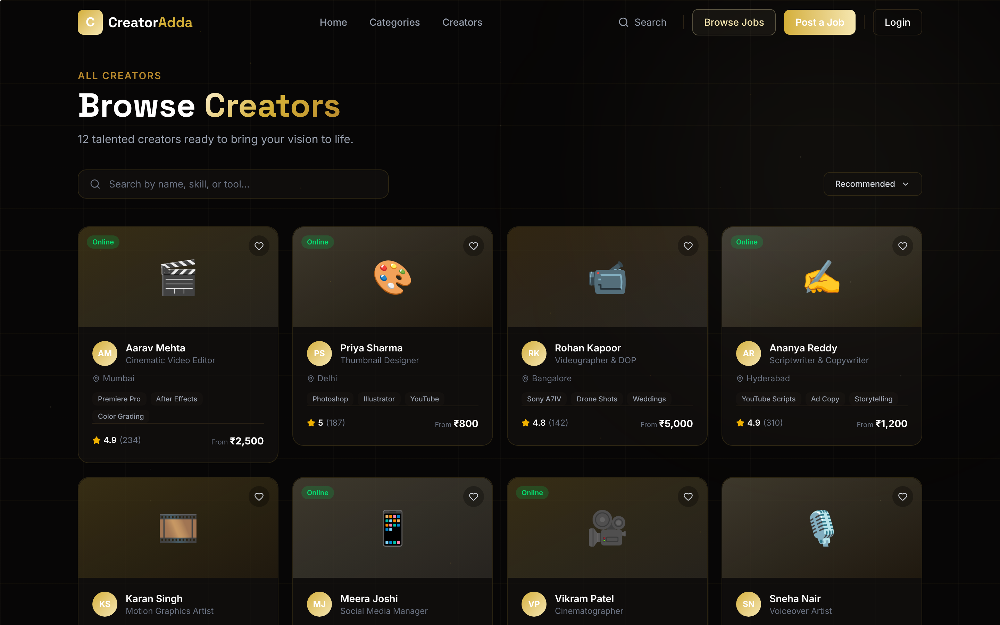
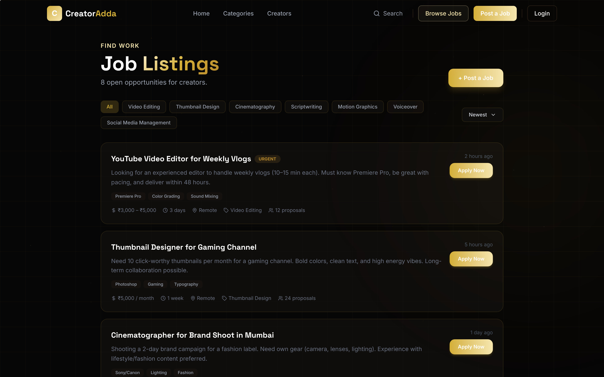

<p align="center">
  
</p>

<h1 align="center">Creator Adda</h1>

<p align="center">
  <strong>A marketplace connecting India's creative professionals with brands and clients</strong>
</p>

<p align="center">
  <a href="https://github.com/Gyanendra66/creator-adda/actions/workflows/ci.yml"></a>
  <a href="LICENSE"></a>
  
  
  
</p>

<p align="center">
  <a href="#features">Features</a> •
  <a href="#tech-stack">Tech Stack</a> •
  <a href="#getting-started">Getting Started</a> •
  <a href="#project-structure">Project Structure</a> •
  <a href="#deployment">Deployment</a> •
  <a href="#contributing">Contributing</a> •
  <a href="#license">License</a>
</p>

<p align="center">
  
  
</p>

---

## 🎬 About

**Creator Adda** is a full-featured marketplace platform that connects creative professionals — videographers, video editors, thumbnail artists, scriptwriters, cinematographers, and voiceover artists — with brands and clients looking to hire top talent.

Whether you're a creator looking for your next gig or a brand searching for the perfect creative partner, Creator Adda makes it seamless.

### 📌 Project Status

Creator Adda is a working front-end with real authentication and job posting, under active development:

- **Live with Firebase:** sign-up / login (Email, Google, GitHub), account profile and settings, posting and managing jobs
- **Sample data:** the creator listings, search results, and the numbers shown on the landing and About pages are placeholder content for the UI
- **Not built yet:** messaging between clients and creators, payments, reviews

---

## ✨ Features

### For Creators
- **Profile & Portfolio** — Showcase your skills, set your rates (starting from ₹800), and display your ratings
- **Job Discovery** — Browse and apply to posted jobs across creative categories
- **Account Dashboard** — Manage your profile, settings, and posted jobs

### For Clients & Brands
- **Post Jobs** — Describe your project and find the right creative talent
- **Browse Creators** — Filter by category, rating, price, and availability
- **Search** — Powerful search across all creators and services

### Platform Features
- **🔐 Authentication** — Sign up with Email, Google, or GitHub
- **🎨 Dark Theme** — Dark UI with gold accents
- **🎥 3D Interactive Hero** — WebGL-powered floating camera model with mouse tracking
- **⚡ Blazing Fast** — Code-split routes with lazy loading for optimal performance
- **📱 Fully Responsive** — Works beautifully on desktop, tablet, and mobile
- **🎞️ Smooth Animations** — Page transitions, scroll animations, and micro-interactions powered by Framer Motion
- **🔝 Scroll Progress** — Visual scroll indicator and back-to-top button
- **✨ Cursor Glow** — Custom cursor glow effect for an immersive experience

---

## 🏗️ Tech Stack

| Layer | Technology |
|-------|-----------|
| **Framework** | [React 19](https://react.dev/) with TypeScript |
| **Build Tool** | [Vite 7](https://vitejs.dev/) |
| **Styling** | [Tailwind CSS 4](https://tailwindcss.com/) |
| **3D Graphics** | [Three.js](https://threejs.org/) + [React Three Fiber](https://docs.pmnd.rs/react-three-fiber) + [Drei](https://github.com/pmndrs/drei) |
| **Animations** | [Framer Motion](https://www.framer.com/motion/) |
| **Icons** | [Lucide React](https://lucide.dev/) |
| **Routing** | [React Router v7](https://reactrouter.com/) |
| **Backend** | [Firebase](https://firebase.google.com/) (Auth, Firestore, Hosting) |
| **Auth Providers** | Email/Password, Google, GitHub |

---

## 🚀 Getting Started

### Prerequisites

- [Node.js](https://nodejs.org/) (v20 or higher)
- [npm](https://www.npmjs.com/) or [yarn](https://yarnpkg.com/)
- A [Firebase](https://firebase.google.com/) project (for authentication & database)

### Installation

1. **Clone the repository**
   ```bash
   git clone https://github.com/Gyanendra66/creator-adda.git
   cd creator-adda
   ```

2. **Install dependencies**
   ```bash
   npm install
   ```

3. **Set up environment variables**

   Copy the example env file and fill in your Firebase credentials:
   ```bash
   cp .env.example .env
   ```

   Edit `.env` with your Firebase config:
   ```env
   VITE_FIREBASE_API_KEY=your_api_key
   VITE_FIREBASE_AUTH_DOMAIN=your_project.firebaseapp.com
   VITE_FIREBASE_PROJECT_ID=your_project_id
   VITE_FIREBASE_STORAGE_BUCKET=your_project.appspot.com
   VITE_FIREBASE_MESSAGING_SENDER_ID=your_sender_id
   VITE_FIREBASE_APP_ID=your_app_id
   VITE_FIREBASE_MEASUREMENT_ID=your_measurement_id
   ```

4. **Start the development server**
   ```bash
   npm run dev
   ```

   The app will be running at `http://localhost:5173`

---

## 📁 Project Structure

```
creator-adda/
├── docs/                    # README screenshots
├── public/                  # Static assets
├── src/
│   ├── components/          # Reusable UI components
│   │   ├── AnimatedCounter.tsx    # Animated number counters
│   │   ├── BackToTop.tsx          # Back-to-top floating button
│   │   ├── BrandMarquee.tsx       # Scrolling creative tools marquee
│   │   ├── Categories.tsx         # Creator category cards
│   │   ├── CreatorFeed.tsx        # Featured creator cards
│   │   ├── CursorGlow.tsx         # Custom cursor glow effect
│   │   ├── Footer.tsx             # Site footer
│   │   ├── Hero.tsx               # Hero section with CTA
│   │   ├── HeroScene.tsx          # 3D Three.js camera scene
│   │   ├── HowItWorks.tsx         # 3-step process timeline
│   │   ├── Navbar.tsx             # Navigation bar
│   │   ├── PageTransition.tsx     # Framer Motion page transitions
│   │   ├── ScrollProgress.tsx     # Scroll progress indicator
│   │   ├── ScrollToTop.tsx        # Auto scroll-to-top on navigate
│   │   ├── SilentErrorBoundary.tsx # Keeps the page up if the 3D scene fails
│   │   └── Typewriter.tsx         # Typewriter text animation
│   ├── lib/
│   │   └── firebase.ts           # Firebase config, auth & Firestore
│   ├── pages/                    # Route-level page components
│   │   ├── HomePage.tsx           # Landing page
│   │   ├── CategoriesPage.tsx     # Browse categories
│   │   ├── CreatorsPage.tsx       # Browse creators
│   │   ├── CreatorProfilePage.tsx # Individual creator profile
│   │   ├── SearchPage.tsx         # Search results
│   │   ├── PostJobPage.tsx        # Post a new job
│   │   ├── JobsPage.tsx           # Browse jobs
│   │   ├── LoginPage.tsx          # Login
│   │   ├── RegisterPage.tsx       # Registration
│   │   ├── AccountDashboardPage.tsx # User dashboard
│   │   ├── AccountProfilePage.tsx   # Edit profile
│   │   ├── AccountSettingsPage.tsx  # Account settings
│   │   ├── PricingPage.tsx        # Pricing plans
│   │   ├── AboutPage.tsx          # About us
│   │   ├── CareersPage.tsx        # Careers
│   │   ├── BlogPage.tsx           # Blog
│   │   ├── PressPage.tsx          # Press/media
│   │   ├── HelpCenterPage.tsx     # Help & support
│   │   ├── TrustSafetyPage.tsx    # Trust & safety
│   │   ├── TermsPage.tsx          # Terms of service
│   │   ├── PrivacyPage.tsx        # Privacy policy
│   │   └── NotFoundPage.tsx       # 404 page
│   ├── App.tsx                   # Root app with routing
│   ├── main.tsx                  # Entry point
│   └── index.css                 # Global styles
├── .env.example                  # Environment variable template
├── firebase.json                 # Firebase hosting configuration
├── vite.config.ts                # Vite build configuration
├── tsconfig.json                 # TypeScript configuration
└── package.json                  # Dependencies & scripts
```

---

## 🏠 Pages & Routes

| Route | Page | Description |
|-------|------|-------------|
| `/` | Home | Landing page with hero, categories, how it works, creator feed |
| `/categories` | Categories | Browse all creator categories |
| `/creators` | Creators | Browse and filter creators |
| `/creator/:id` | Creator Profile | View a creator's profile and portfolio |
| `/search` | Search | Search for creators and services |
| `/post-job` | Post a Job | Create a new job listing |
| `/jobs` | Jobs | Browse available jobs |
| `/login` | Login | Sign in with email, Google, or GitHub |
| `/register` | Register | Create a new account |
| `/account` | Dashboard | User account dashboard |
| `/account/profile` | Profile | Edit your profile |
| `/account/settings` | Settings | Account settings |
| `/pricing` | Pricing | View pricing plans |
| `/about` | About | About Creator Adda |
| `/careers` | Careers | Job openings at Creator Adda |
| `/blog` | Blog | Latest articles and updates |
| `/press` | Press | Press releases and media |
| `/help` | Help Center | FAQs and support |
| `/trust-safety` | Trust & Safety | Safety guidelines |
| `/terms` | Terms | Terms of service |
| `/privacy` | Privacy | Privacy policy |

---

## 📦 Available Scripts

| Command | Description |
|---------|-------------|
| `npm run dev` | Start development server on `localhost:5173` |
| `npm run build` | Type-check and build for production |
| `npm run preview` | Preview the production build locally |
| `npm run deploy` | Build and deploy to Firebase Hosting |

---

## 🌐 Deployment

This project is configured for **Firebase Hosting**.

1. **Install Firebase CLI** (if not already):
   ```bash
   npm install -g firebase-tools
   ```

2. **Login to Firebase**:
   ```bash
   firebase login
   ```

3. **Deploy**:
   ```bash
   npm run deploy
   ```

   This will build the project and deploy it to Firebase Hosting in one command.

---

## 🎨 Creator Categories

Videographers · Video Editors · Thumbnail Artists · Scriptwriters · Cinematographers · Voiceover Artists

---

## 🤝 Contributing

Contributions are welcome! Please read our [Contributing Guide](CONTRIBUTING.md) and [Code of Conduct](CODE_OF_CONDUCT.md) before submitting a pull request.

1. Fork the repository
2. Create your feature branch (`git checkout -b feature/amazing-feature`)
3. Commit your changes (`git commit -m 'Add amazing feature'`)
4. Push to the branch (`git push origin feature/amazing-feature`)
5. Open a Pull Request

---

## 📄 License

This project is licensed under the MIT License — see the [LICENSE](LICENSE) file for details.

---

## 👤 Author

**Gyanendra Singh**
- GitHub: [@Gyanendra66](https://github.com/Gyanendra66)
- Email: gyanendrasingh1066@gmail.com

---

<p align="center">
  Made with ❤️ in India
</p>
